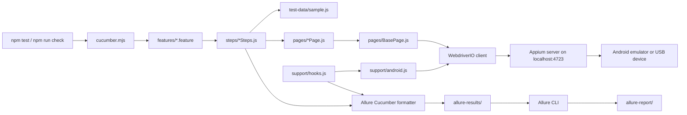

# Mobile Automation Architecture

## Purpose

This project is an Android UI automation suite for the Sauce Labs Sample App. Cucumber defines behavior in Gherkin, WebdriverIO sends Appium commands, page objects model the app screens, and Allure turns scenario results and attachments into an HTML report. The current run is serial on one Android emulator or device.

## Runtime flow



## Main components

- **Runner and features:** `cucumber.mjs` discovers Gherkin features and step modules. Normal runs use the progress and Allure formatters with parallel execution and retries disabled. The `check` profile enables Cucumber dry-run matching, so it checks scenario-to-step bindings without starting Appium or altering the latest report.
- **Features and steps:** Files in `features/` state user-visible behavior. Use `user` as the actor in every step: Given establishes state, When describes a user action, and Then states an observable outcome. Files named `*Steps.js` translate those steps into page calls and use the sample values in `test-data/`. `CatalogSteps.js` binds sorting and product-detail scenarios. Step files express flows, not selectors or low-level gestures.
- **Page objects:** Files named `*Page.js` own selectors and actions for a screen. `BasePage.js` provides shared accessibility and text locators, displayed-element waits, taps, text entry, keyboard handling, and bounded scrolling. `ProductsPage.js` handles catalog sorting and selection; `ProductDetailsPage.js` waits for the selected product's name and price. Screen-specific outcomes, such as an empty cart or checkout confirmation, remain in their page object.
- **Support and device session:** The Cucumber `Before` hook calls `support/android.js`, which validates the APK path and creates a WebdriverIO remote session to the local Appium server with Android UiAutomator2 capabilities. `ANDROID_SERIAL` selects a device when more than one is connected. `APP_APK` overrides the bundled APK path. The full reset capability reinstalls the app for each scenario.
- **Scenario cleanup and evidence:** The `After` hook captures and attaches a PNG when a scenario fails, then attempts to close its session even if screenshot capture fails. A session-start failure is reported by the setup hook because there is no active driver to capture.
- **Results and reports:** Each scenario and its Gherkin steps are written to `allure-results/`. The test pre-hook clears old raw results before a fresh run. `npm.cmd run report:generate` creates the HTML report in `allure-report/`, and `npm.cmd run report:open` serves it locally.

## Proposed utility layer

The utilities below are the approved next architecture extension and have not been implemented yet.

```text
utils/
  Logger.js
  RandomUtils.js
  WaitUtils.js
test-data/
  sample.js
  customer.js
```

Utilities hold small reusable behavior and do not own Appium sessions, screens, or scenario flow. `WaitUtils.js` centralizes common WebdriverIO element-wait defaults while page objects retain semantic methods such as `waitForCart()`. `RandomUtils.js` uses Node's built-in crypto utilities for bounded random values. `test-data/customer.js` uses those values to create safe fake checkout data and the checkout scenario attaches the generated values to Allure for failure diagnosis. Credentials and product names remain fixed in `sample.js`. `Logger.js` offers consistent info, warning, and error messages through Node's built-in console. Driver creation remains under `support/`. Avoid a generic `Helper.js`; add a named helper only when reusable behavior appears.

## Development and verification

Run these commands from the project folder:

- `npm.cmd run check` verifies Gherkin bindings without a device.
- `npm.cmd test` runs all nine scenarios on a configured Android device.
- `npm.cmd test -- --tags "@smoke"` runs the two smoke scenarios.
- `npm.cmd run report:generate` generates the current Allure report.
- `npm.cmd run report:open` opens the generated report.

The full Android run passed all nine scenarios and 72 steps on `emulator-5554` in 3m 14.688s. Utility tests should be added when the proposed utility modules are implemented.
